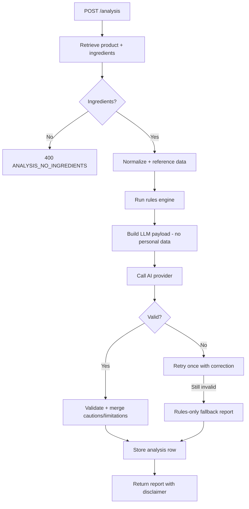

# Analysis API (Phase 4)

The analysis API under `/api/v1/analysis` provides AI-generated educational
ingredient reports. All endpoints require authentication.

## Endpoints

### `POST /api/v1/analysis`

Run an ingredient analysis for a product. Body:

```json
{
  "product_id": "uuid"
}
```

Optional query param: `force_refresh=true` (rate-limited, bypasses cache).

The pipeline runs in 7 steps:
1. **Retrieve** – load product and ordered ingredients. Returns
   `400 ANALYSIS_NO_INGREDIENTS` if none parsed.
2. **Normalize** – use existing normalized ingredient records.
3. **Reference** – attach reference data (description, function, safety notes,
   irritation potential, reviewed flag).
4. **Rules** – deterministic rules engine (fragrance, drying alcohol, actives,
   comedogenic, ingredient order, unreviewed ingredients).
5. **LLM** – send minimal structured data (product name, ingredients with
   reference data, rule findings, skin_type, skin_concerns). No personal data.
6. **Validate** – Pydantic schema + banned-phrase check + caution-level merge;
   retry once with corrective instruction; fallback to rules-only report.
7. **Display** – store and return the report.

Response (201):

```json
{
  "id": "uuid",
  "product_id": "uuid",
  "status": "completed",
  "model_used": "fake-local",
  "prompt_version": "v1",
  "rules_version": "v1",
  "latency_ms": 0,
  "input_tokens": null,
  "output_tokens": null,
  "error_code": null,
  "created_at": "2026-11-07T10:00:00",
  "result": {
    "summary": "...",
    "suitability_overview": "...",
    "key_ingredients": [...],
    "cautions": [...],
    "limitations": [...],
    "confidence": "medium",
    "confidence_reason": "..."
  },
  "product_unverified": false
}
```

Error codes:
- `ANALYSIS_NO_INGREDIENTS` (400) – product has no parsed ingredients.
- `ANALYSIS_LIMIT_REACHED` (429) – daily or per-minute limit exceeded.
- `AI_PROVIDER_UNAVAILABLE` – provider unreachable; degrades to fallback.
- `AI_RATE_LIMITED` – provider rate-limited; degrades to fallback.
- `AI_INVALID_RESPONSE` – provider output failed validation twice; fallback.
- `PRODUCT_NOT_FOUND` (404) – product doesn't exist.

### `GET /api/v1/analysis`

Current user's analysis history, newest first. Query: `limit` (1-100), `offset`.

Response:

```json
{
  "items": [...],
  "total": 10,
  "limit": 20,
  "offset": 0
}
```

### `GET /api/v1/analysis/{id}`

Single analysis report. Only the owner can read; others get 404.

### `DELETE /api/v1/analysis/{id}`

Delete an analysis owned by the current user. Returns 204.

### `GET /api/v1/analysis/admin/stats` (admin only)

Cost/usage stats:

```json
{
  "total_analyses": 150,
  "completed": 120,
  "fallback": 25,
  "fallback_rate": 0.1667,
  "recent_7_days": 45,
  "total_tokens": 34200,
  "avg_latency_ms": 850.5
}
```

## Error Codes

| Code | HTTP | Meaning |
|------|------|---------|
| `ANALYSIS_NO_INGREDIENTS` | 400 | Product has no parsed ingredients |
| `ANALYSIS_LIMIT_REACHED` | 429 | Daily or per-minute rate limit |
| `AI_PROVIDER_UNAVAILABLE` | 200 (fallback) | Provider unreachable; fallback report |
| `AI_RATE_LIMITED` | 200 (fallback) | Provider rate-limited; fallback report |
| `AI_INVALID_RESPONSE` | 200 (fallback) | Provider output invalid twice; fallback |
| `PRODUCT_NOT_FOUND` | 404 | Product doesn't exist |
| `AUTH_FORBIDDEN` | 403 | Non-admin accessing admin endpoint |

## Pipeline Flowchart



## Caching

Analyses are cached by `input_hash` (product ingredients + reference versions +
skin profile + prompt_version + rules_version). Cached results are returned
without calling the LLM and do not count toward daily limits.

## Rate Limits

- Per-minute: 10 analyses per user.
- Per-day: `ANALYSIS_DAILY_LIMIT` (default 20) analyses per user.
- Cached results do not count toward limits.

## Privacy

Only product name, ingredients, reference data, rule findings, `skin_type`, and
`skin_concerns` are sent to the LLM. Email, name, and user id are never
included. Prompts and model outputs are not logged in full.

## Environment Variables

| Variable | Default | Purpose |
|----------|---------|---------|
| `AI_PROVIDER` | `fake` | `fake`, `anthropic`, or `openrouter` |
| `AI_MODEL` | `claude-3-haiku-20240307` | Anthropic model name (no hardcoding) |
| `AI_MAX_TOKENS` | `1000` | Max tokens per request |
| `AI_TIMEOUT_SECONDS` | `30.0` | Provider timeout |
| `AI_PROVIDER_API_KEY` | `` | Anthropic API key |
| `OPENROUTER_API_KEY` | `` | OpenRouter API key (free models still require a key) |
| `OPENROUTER_MODEL` | `google/gemma-4-31b-it:free` | Free OpenRouter model |
| `OPENROUTER_TIMEOUT_SECONDS` | `30.0` | OpenRouter request timeout |
| `ANALYSIS_DAILY_LIMIT` | `20` | Per-user daily analysis limit |
