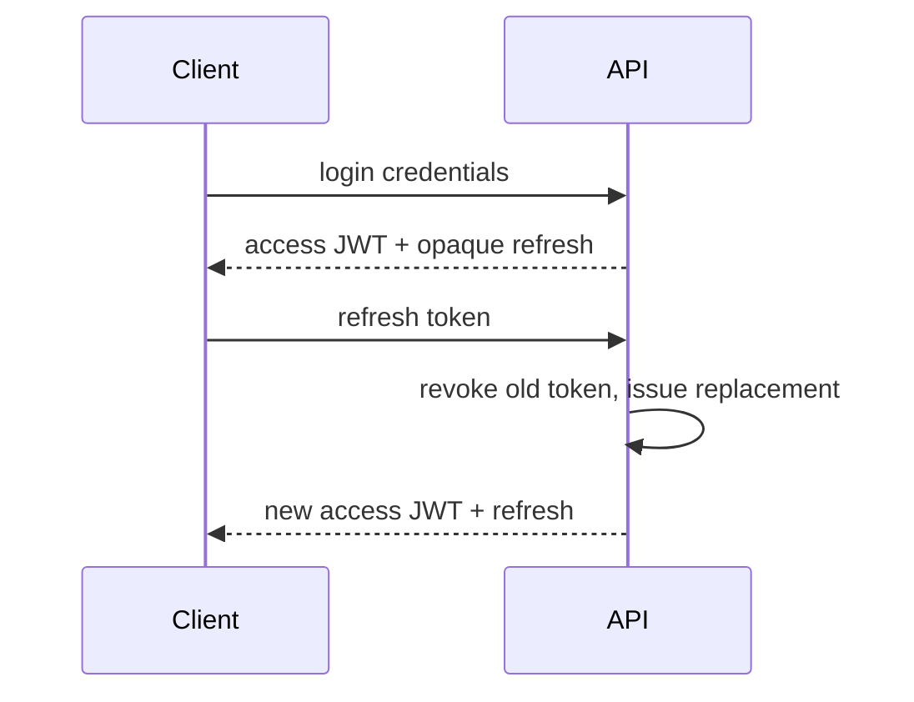

# Authentication

`POST /api/v1/auth/signup` accepts `{ "email", "password", "full_name" }`; `POST /login` accepts email/password. Both return a user, 15-minute bearer access token, and 30-day opaque refresh token.

`POST /refresh` accepts `{ "refresh_token" }`, rotates it, and rejects reused rotated tokens after revoking their family. `POST /logout` accepts a refresh token. `POST /logout-all`, `POST /change-password`, and `GET /me` require `Authorization: Bearer <access token>`.

Profile endpoints are `GET` and `PUT /api/v1/users/me/profile`; `DELETE /api/v1/users/me` deactivates the account. Errors use `AUTH_INVALID_CREDENTIALS`, `AUTH_TOKEN_INVALID`, `AUTH_TOKEN_EXPIRED`, `AUTH_FORBIDDEN`, and `AUTH_EMAIL_TAKEN`.

