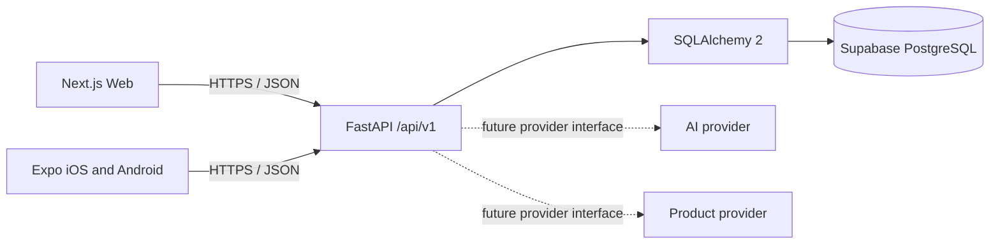

# Architecture overview

The clients are separate because web and native mobile have different navigation, rendering, and deployment needs. They share one API contract and database so validation, business rules, and persistence remain centralized. Request flow is client → versioned FastAPI router → service layer → SQLAlchemy session → PostgreSQL. The Week 1 clients only read the health endpoint.

## Decisions

- UUID identifiers and timezone-aware server timestamps are used throughout the relational schema.
- The same FastAPI API serves all clients; clients never connect to PostgreSQL directly.
- The health route degrades gracefully and reports database reachability instead of failing the whole endpoint.
- Provider integrations are abstract interfaces only. No credentials are needed to run without those providers.
- Auth is deferred to Weeks 2–3; the `users` table reserves role and password hash fields without exposing account routes.
- See [decisions](decisions.md) and [database schema](../database/schema.md).
