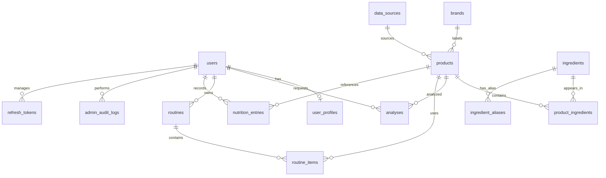

# Database schema

All PostgreSQL tables use UUID primary keys and server-generated timezone-aware `created_at` and `updated_at` timestamps. Foreign key deletion behavior protects user ownership while allowing catalog references to be removed safely. MongoDB is configured as a secondary document database; no collections are created until a feature defines their ownership and schema.

| Table | Purpose and constraints |
| --- | --- |
| `users` | Unique email, Argon2 hash, `role` enum (`user`, `admin`), `is_active`, `is_email_verified`, `last_login_at`. |
| `refresh_tokens` | Hashed opaque tokens with user, family, expiry, revocation and replacement metadata; refresh rotation detects reuse. |
| `user_profiles` | One-to-one user preferences; cascades on user deletion. Stores name, skin concerns, preferences, onboarding state. |
| `brands` | Unique searchable brand name; protected from deletion by products via `SET NULL`. |
| `data_sources` | Named provenance sources: `internal_admin`, `open_beauty_facts`, `user_submitted`, `development_seed`. |
| `products` | Optional brand/source, unique barcode, indexed name/category/`is_active`, `verification_status` enum, `ingredients_raw_text`, external id, image, soft-delete flag, verified metadata, creator. |
| `ingredients` | Unique indexed `normalized_name`, functional category, description, `is_reviewed`, `is_active`. |
| `ingredient_aliases` | Unique normalized alias mapped to one ingredient; cascades with the ingredient. |
| `product_ingredients` | Product/ingredient join, unique pair, optional position/concentration/original text. |
| `analyses` | User, optional product, JSONB `structured_result`, model name. |
| `routines` | User-owned named morning/evening routine. |
| `routine_items` | Ordered routine steps, unique routine/position pair. |
| `nutrition_entries` | User record with timestamp, quantity, optional JSONB nutrients/product. |
| `admin_audit_logs` | Optional admin actor, action/entity reference, `before_summary`/`after_summary`, JSONB metadata. |

Migration `0003_phase3_catalog` adds `ingredients.is_reviewed`, `ingredients.is_active` and catalogue indexes; on PostgreSQL it also creates the `pg_trgm` extension and trigram GIN indexes for name/search fields. `development_seed` is created by the seed script, not by migrations.

User-owned records cascade when their user/routine/product ingredient parent is deleted. Optional catalog references and audit actors use `SET NULL` where retaining the record is useful. See `backend/alembic/versions/` for the exact column definitions; `upgrade head` and `downgrade -1` are tested for the Phase 3 revision.
