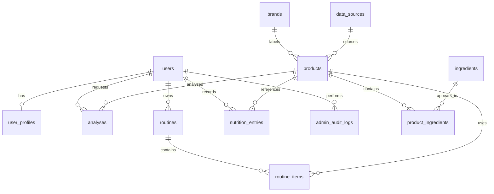

# Database schema

All PostgreSQL tables use UUID primary keys and server-generated timezone-aware `created_at` and `updated_at` timestamps. Foreign key deletion behavior protects user ownership while allowing catalog references to be removed safely. MongoDB is configured as a secondary document database; no collections are created until a feature defines their ownership and schema.

| Table | Purpose and constraints |
| --- | --- |
| `users` | Unique email, password hash placeholder, `role` enum (`user`, `admin`). |
| `refresh_tokens` | Hashed opaque tokens with user, family, expiry, revocation and replacement metadata; refresh rotation detects reuse. |
| `user_profiles` | One-to-one user preferences; cascades on user deletion. |
| `brands` | Unique searchable brand name. |
| `data_sources` | Named provenance sources for catalog data. |
| `products` | Optional brand/source, unique barcode, indexed name, verification enum (`unverified`, `verified`, `rejected`). |
| `ingredients` | Name, unique indexed `normalized_name`, description, reference notes. |
| `product_ingredients` | Product/ingredient join, unique pair, optional position/concentration. |
| `analyses` | User, optional product, JSONB `structured_result`, model name. |
| `routines` | User-owned named morning/evening routine. |
| `routine_items` | Ordered routine steps, unique routine/position pair. |
| `nutrition_entries` | User record with timestamp, quantity, optional JSONB nutrients/product. |
| `admin_audit_logs` | Optional admin actor, action and entity reference, JSONB metadata. |

User-owned records cascade when their user/routine/product ingredient parent is deleted. Optional catalog references and audit actors use `SET NULL` where retaining the record is useful. See Alembic revision `0001_initial_schema` for the exact column definitions.
